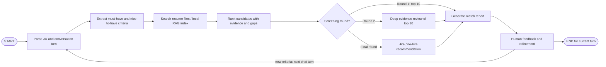

# Matching agent state machine

Each turn ends after the feedback node and the CLI accepts another turn using
the same state. Round 1 ranks the whole corpus and returns at most ten
candidates; round 2 adds evidence text for those ten; final round applies an
explicit threshold to produce a hire/no-hire recommendation. The next user
message can refine criteria and triggers a fresh search and ranking. Scores
support human review and are not a hiring decision by themselves. Retrieval
uses local TF-IDF over resume text.
